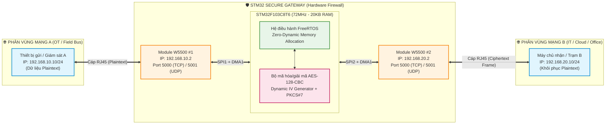
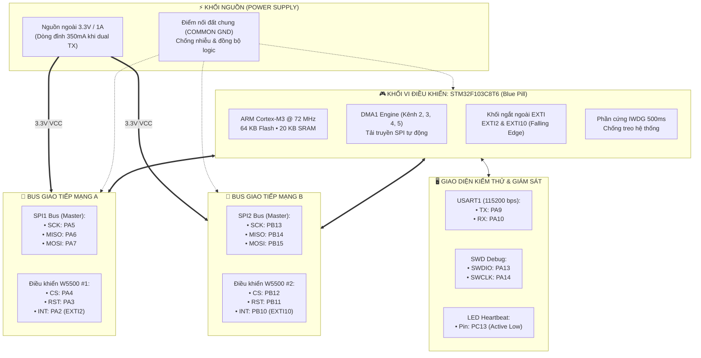
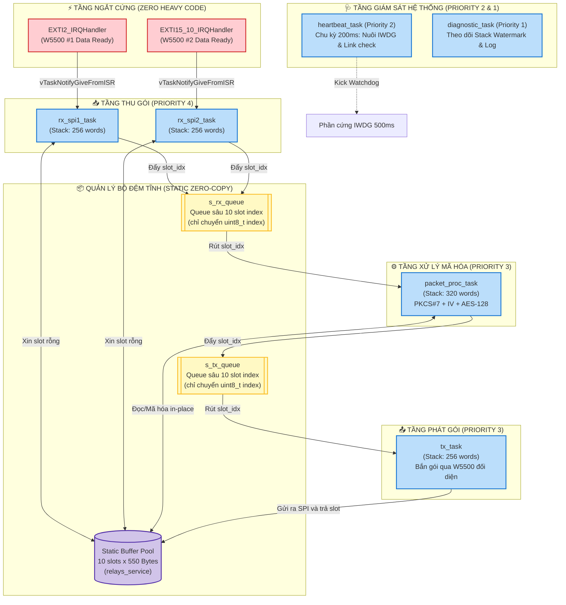
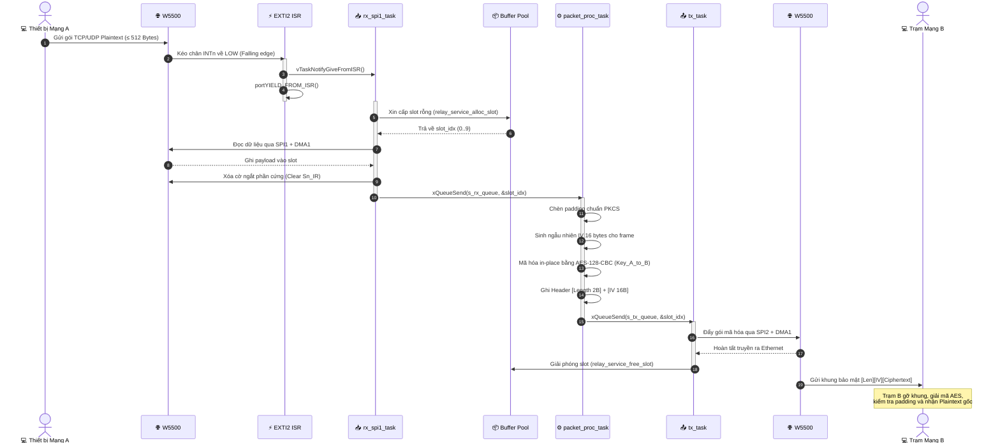

# 🛡️ Secure Gateway AES-128 STM32 (Dual W5500)

<div align="center">

-002B49?style=for-the-badge&logo=stmicroelectronics)
-008FBA?style=for-the-badge)


**Cổng Chuyển Tiếp Bảo Mật Phần Cứng Hai Chiều Tốc Độ Cao Cho Mạng Công Nghiệp & IoT**  
*Tách biệt mạng vật lý (Hardware Air-Gap) • Mã hóa đường truyền AES-128-CBC • Đa nhiệm thời gian thực FreeRTOS*

</div>

---

## 📑 Mục Lục
1. [Giới thiệu & Bài toán giải quyết](#1-giới-thiệu--bài-toán-giải-quyết)
2. [Sơ đồ khối tổng thể dự án (System Overview)](#2-sơ-đồ-khối-tổng-thể-dự-án-system-overview)
3. [Sơ đồ khối kiến trúc phần cứng (Hardware Architecture)](#3-sơ-đồ-khối-kiến-trúc-phần-cứng-hardware-architecture)
4. [Sơ đồ khối kiến trúc phần mềm & FreeRTOS Pipeline](#4-sơ-đồ-khối-kiến-trúc-phần-mềm--freertos-pipeline)
5. [Cấu trúc khung bảo mật & Luồng mã hóa (Cryptographic Pipeline)](#5-cấu-trúc-khung-bảo-mật--luồng-mã-hóa-cryptographic-pipeline)
6. [Sơ đồ tuần tự truyền nhận dữ liệu (Sequence Diagram)](#6-sơ-đồ-tuần-tự-truyền-nhận-dữ-liệu-sequence-diagram)
7. [Bản đồ tài nguyên bộ nhớ (SRAM & Flash Map)](#7-bản-đồ-tài-nguyên-bộ-nhớ-sram--flash-map)
8. [Cấu trúc thư mục mã nguồn](#8-cấu-trúc-thư-mục-mã-nguồn)

---

## 1. Giới thiệu & Bài toán giải quyết

Trong các môi trường điều khiển công nghiệp (OT/SCADA) hoặc mạng IoT nội bộ, việc kết nối trực tiếp giữa **Mạng A** (Mạng thiết bị/Cảm biến trường nhạy cảm) và **Mạng B** (Mạng điều hành/Doanh nghiệp/Cloud) tiềm ẩn nguy cơ bảo mật nghiêm trọng:
- Nghe lén dữ liệu truyền thông dạng văn bản thô (Plaintext Sniffing).
- Tấn công xen giữa (Man-in-the-Middle) và giả mạo gói tin (Data Tampering).
- Nguy cơ mã độc lây lan tự do giữa các phân vùng mạng khi nối bridge/router thông thường.

**Secure Gateway STM32** đóng vai trò là "chốt kiểm soát an ninh phần cứng" nằm độc lập giữa 2 mạng:
- **Tách biệt mạng vật lý hoàn toàn**: Sử dụng 2 chip Ethernet độc lập W5500 trên 2 bus SPI riêng biệt.
- **Mã hóa trong suốt (Transparent In-Line Encryption)**: Toàn bộ gói tin (TCP/UDP) đi qua gateway được tự động đóng gói, thêm padding PKCS#7, sinh mã ngẫu nhiên IV 16-byte riêng cho từng frame và mã hóa bằng **AES-128-CBC**.
- **Chống tấn công phát lại (Anti-Reflection)**: Sử dụng 2 bộ Secret Key đối xứng tách biệt cho 2 chiều: `Key_A_to_B` và `Key_B_to_A`.
- **Độ tin cậy thời gian thực cao**: Vận hành trên FreeRTOS với kiến trúc **Zero-Malloc** (cấp phát tĩnh 100%), bảo vệ bằng Independent Watchdog (IWDG 500ms).

---

## 2. Sơ đồ khối tổng thể dự án (System Overview)

Dưới đây là sơ đồ khối mức cao thể hiện luồng liên lạc an toàn giữa Mạng A và Mạng B thông qua Gateway:



---

## 3. Sơ đồ khối kiến trúc phần cứng (Hardware Architecture)

Hệ thống phần cứng bao gồm bo mạch STM32F103C8T6 (Blue Pill), 2 module Ethernet WIZnet W5500 giao tiếp độc lập, mạch cấp nguồn chuyên dụng và cổng giao tiếp máy tính:



### Bảng cấu hình chân phần cứng (Pinout Mapping)

| Thiết bị ngoại vi | Chân STM32 | Chức năng chi tiết | Ghi chú kỹ thuật |
| :--- | :--- | :--- | :--- |
| **W5500 #1 (Net A)** | `PA4` | SPI1 Chip Select (CS) | Tích cực mức thấp (Active LOW) |
| | `PA5` / `PA6` / `PA7` | SPI1 SCK / MISO / MOSI | Giao tiếp tốc độ cao với DMA1 |
| | `PA3` | Hardware Reset (RST) | Kéo LOW tối thiểu 500µs để reset |
| | `PA2` | Interrupt Request (INTn) | Kích hoạt ngắt ngoài `EXTI2` (Falling edge) |
| **W5500 #2 (Net B)** | `PB12` | SPI2 Chip Select (CS) | Tích cực mức thấp (Active LOW) |
| | `PB13` / `PB14` / `PB15` | SPI2 SCK / MISO / MOSI | Giao tiếp tốc độ cao với DMA1 |
| | `PB11` | Hardware Reset (RST) | Kéo LOW tối thiểu 500µs để reset |
| | `PB10` | Interrupt Request (INTn) | Kích hoạt ngắt ngoài `EXTI15_10` (Falling edge) |
| **Hệ thống & Debug** | `PA9` / `PA10` | USART1 TX / RX | Log kiểm tra trạng thái (115200-8-N-1) |
| | `PC13` | Onboard LED | Báo hiệu nhịp tim Heartbeat (Đảo trạng thái mỗi 200ms) |
| | `PA13` / `PA14` | SWDIO / SWCLK | Nạp firmware và debug ST-Link V2 |

> ⚠️ **Lưu ý phần cứng quan trọng**: Hai module W5500 khi hoạt động đồng thời có thể tiêu thụ dòng đỉnh lên đến **300 - 350 mA**. Bắt buộc phải cấp nguồn 3.3V ngoài có dòng danh định tối thiểu 1A và **nối chung toàn bộ chân GND** của nguồn, STM32 và 2 module W5500.

---

## 4. Sơ đồ khối kiến trúc phần mềm & FreeRTOS Pipeline

Toàn bộ phần mềm được thiết kế theo mô hình phân tầng hướng kiến trúc (Layered Architecture) 4 lớp nghiêm ngặt, triệt tiêu sự phụ thuộc vòng:

```text
Tầng 1 (Application & Tasks) ──▶ Tầng 2 (Services) ──▶ Tầng 3 (BSP) ──▶ Tầng 4 (STM32 HAL / Kernel)
```

### Sơ đồ luồng xử lý đa nhiệm (FreeRTOS Task Architecture)



### Nguyên tắc quản lý Buffer Ownership (Zero-Copy)

Nhằm tối ưu hóa tài nguyên RAM hạn hẹp (20 KB) của STM32F103, hệ thống sử dụng cơ chế **chuyển quyền sở hữu đệm (Ownership Transfer)**:
1. Các hàng đợi FreeRTOS (`s_rx_queue`, `s_tx_queue`) chỉ vận chuyển **chỉ số mảng `uint8_t slot_idx` (0 đến 9)**, không sao chép toàn bộ mảng dữ liệu.
2. Vòng đời của 1 slot bộ đệm:
   $$\text{FREE (Rỗi)} \xrightarrow{\text{RX Task}} \text{RX Queue} \xrightarrow{\text{Proc Task}} \text{Mã hóa In-Place} \xrightarrow{\text{TX Queue}} \text{TX Task} \xrightarrow{\text{Gửi xong}} \text{FREE}$$
3. Trường hợp nghẽn hàng đợi hoặc lỗi đường truyền, slot sẽ được giải phóng ngay lập tức để tránh rò rỉ bộ đệm (Buffer Leak).

---

## 5. Cấu trúc khung bảo mật & Luồng mã hóa (Cryptographic Pipeline)

### Định dạng khung truyền bảo mật (Wire Frame Format)

Gói tin truyền giữa các gateway được đóng gói theo định dạng chuẩn nhị phân có độ dài xác định:

```text
 0                   1                   2                   3
 0 1 2 3 4 5 6 7 8 9 0 1 2 3 4 5 6 7 8 9 0 1 2 3 4 5 6 7 8 9 0 1
+-+-+-+-+-+-+-+-+-+-+-+-+-+-+-+-+-+-+-+-+-+-+-+-+-+-+-+-+-+-+-+-+
|       LENGTH (2 Bytes)        |                               |
|          (Big-Endian)         |   INITIALIZATION VECTOR (IV)  |
+-+-+-+-+-+-+-+-+-+-+-+-+-+-+-+-+           (16 Bytes)          |
|                                                               |
|                               +-+-+-+-+-+-+-+-+-+-+-+-+-+-+-+-+
|                               |                               |
+-+-+-+-+-+-+-+-+-+-+-+-+-+-+-+-+                               |
|                                                               |
|                  AES-128-CBC CIPHERTEXT                       |
|           (Bội số 16 Bytes: Từ 16 đến 528 Bytes)              |
|            [Plaintext thô (1-512B) + PKCS#7 Padding]          |
|                                                               |
+-+-+-+-+-+-+-+-+-+-+-+-+-+-+-+-+-+-+-+-+-+-+-+-+-+-+-+-+-+-+-+-+
```

| Trường dữ liệu | Kích thước | Mô tả kỹ thuật |
| :--- | :---: | :--- |
| **Frame Length** | `2 Bytes` | Trường độ dài Big-Endian của `(IV + Ciphertext)`. Giá trị từ `32` đến `544`. |
| **IV (Init Vector)** | `16 Bytes` | Vectơ khởi tạo ngẫu nhiên sinh mới cho từng gói tin bằng PRNG. |
| **Ciphertext** | `16 - 528 Bytes` | Bản mã hóa đầu ra của thuật toán AES-128-CBC sau khi đã chèn đệm PKCS#7. |

### Cơ chế đệm PKCS#7 & Tính toán kích thước

Thuật toán AES yêu cầu khối dữ liệu đầu vào phải là bội số của 16 bytes. Số byte đệm $P$ được tính:
$$P = 16 - (L \pmod{16})$$
*(Trong đó $L$ là độ dài payload plaintext đầu vào)*

- Nếu $L = 512 \text{ bytes} \implies 512 \pmod{16} = 0 \implies P = 16 \text{ bytes}$ (chèn 1 block gồm 16 byte mang giá trị `0x10`).
- Kích thước bản mã cực đại: $512 + 16 = 528 \text{ bytes}$.
- Toàn bộ khung truyền trên dây cáp: $2 \text{ (Header)} + 16 \text{ (IV)} + 528 \text{ (Ciphertext)} = \mathbf{546 \text{ bytes}}$.

---

## 6. Sơ đồ tuần tự truyền nhận dữ liệu (Sequence Diagram)

Quy trình chi tiết từ khi thiết bị tại Mạng A gửi một gói tin thô cho đến khi gói tin được mã hóa và bắn sang Mạng B:



---

## 7. Bản đồ tài nguyên bộ nhớ (SRAM & Flash Map)

Vi điều khiển **STM32F103C8T6** chỉ có **20 KB SRAM** và **64 KB Flash**. Để đảm bảo hệ thống không bao giờ bị tràn bộ nhớ hoặc treo cứng, dự án tuân thủ kiến trúc **Static Allocation 100%**:

```text
+-------------------------------------------------------------------------+
|                  TỔNG DUNG LƯỢNG SRAM: 20,480 BYTES (20 KB)             |
+-------------------------------------------------------------------------+
| [■■■■■■■■■■■■■■■■■■■■■■■■■■■■■■■■■■■■■■■■■■■■■■■■■■■■■■■■■■■□□□□□□□□]   |
|                 Đã dùng: ~17,208 Bytes (~84.0%)  | Còn rỗi: ~3,272 Bytes |
+-------------------------------------------------------------------------+
```

### Chi tiết phân bổ tĩnh vùng nhớ RAM

| Thành phần hệ thống | Số lượng / Kích thước | Tổng RAM | Mục đích sử dụng |
| :--- | :--- | :---: | :--- |
| **FreeRTOS Tasks Stack & TCB** | 5 Task nghiệp vụ + Idle + Timer | ~7,872 B | Vùng ngăn xếp độc lập cho từng luồng RTOS |
| **Static Frame Buffer Pool** | 10 slots $\times$ 550 Bytes | 5,500 B | Bể chứa đệm khung truyền cố định (Zero-Copy) |
| **FreeRTOS IPC Objects** | 2 Queues + 1 Mutex (`s_wiz_mutex`) | ~800 B | Hàng đợi lưu số nguyên và khóa tương hỗ W5500 |
| **Hardware Drivers & HAL State** | WIZnet ioLibrary + HAL handles | ~1,500 B | Biến trạng thái Socket, SPI DMA Descriptors |
| **Main Stack & ISR Stack (MSP)** | Vùng đệm ngắt hệ thống | 1,536 B | Ngăn xếp chạy ngắt ngoài và xử lý ngoại lệ |
| **Vùng nhớ dự phòng an toàn** | Headroom | **~3,272 B** | Ngăn ngừa hiện tượng Stack Overflow |

---

## 8. Cấu trúc thư mục mã nguồn

```bash
secure_gateway_aes_stm32/
├── App/                       # [Tầng 1] Khởi tạo chính ứng dụng
│   ├── Inc/app_main.h
│   └── Src/app_main.c         # Điểm khởi tạo toàn bộ Tasks, Services, BSP
├── Tasks/                     # [Tầng 1] Định nghĩa tác vụ FreeRTOS
│   ├── Inc/gateway_tasks.h
│   └── Src/gateway_tasks.c    # 5 RTOS Tasks: RX1, RX2, Proc, TX, Heartbeat
├── Services/                  # [Tầng 2] Dịch vụ xử lý nghiệp vụ
│   ├── Inc/crypto_service.h   # API mã hóa AES, PKCS#7, quản lý IV
│   ├── Inc/relay_service.h    # Quản lý Static Buffer Pool & Socket state
│   ├── Inc/log_service.h      # Ghi log debug qua UART & DWT cycle counter
│   └── Src/...
├── BSP/                       # [Tầng 3] Board Support Package (Trừu tượng hóa phần cứng)
│   ├── Inc/bsp_w5500.h        # Điều khiển 2 chip W5500 & Mutex bảo vệ
│   ├── Inc/bsp_spi.h          # Driver SPI1/SPI2 truyền nhận DMA
│   ├── Inc/bsp_gpio.h         # Quản lý CS, Reset, EXTI ISR Callbacks
│   ├── Inc/bsp_watchdog.h     # Giao tiếp Independent Watchdog (IWDG)
│   └── Src/...
├── Config/                    # Tham số cấu hình hệ thống
│   ├── Inc/app_config.h       # Buffer dimensions, Timeouts, Pool counts
│   ├── Inc/protocol_config.h  # Bảng cấu hình Static IP, Subnet, MAC, Port
│   └── Inc/crypto_keys.h      # Khóa đối xứng 128-bit cho 2 chiều truyền
├── Core/                      # Tầng HAL do STM32CubeMX sinh ra
│   ├── Inc/FreeRTOSConfig.h   # Cấu hình nhân FreeRTOS (Static alloc enabled)
│   ├── Src/main.c             # Khởi tạo Clock 72MHz, GPIO, DMA, SPI
│   └── Src/freertos.c         # Điểm bắt đầu Default Task khởi chạy app_main
└── Middlewares/               # Thư viện bên thứ ba
    ├── Third_Party/Ethernet/  # Thư viện ioLibrary Driver WIZnet W5500
    ├── Third_Party/FreeRTOS/  # Nhân hệ điều hành thời gian thực FreeRTOS v10
    └── Third_Party/tiny_aes/  # Thư viện mã hóa AES gọn nhẹ cho vi điều khiển
```
