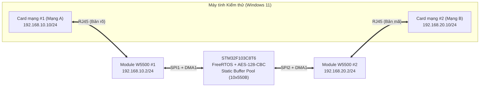

# Secure Gateway AES-128-CBC trên STM32F103 & FreeRTOS

Cổng kết nối chuyển tiếp mã hóa hai chiều (Bidirectional Encrypting Relay) chi phí thấp giữa hai mạng Ethernet riêng biệt, sử dụng vi điều khiển **STM32F103C8T6 (Blue Pill)** chạy **FreeRTOS Native API** kết hợp hai bộ điều khiển Ethernet **W5500** trên hai bus **SPI/DMA** độc lập.

Dự án hiện thực hóa kiến trúc cổng bảo mật theo định hướng mã hóa **AES-128-CBC với Vector khởi tạo (IV) ngẫu nhiên theo từng khung** và các cơ chế tăng độ tin cậy, đồng thời tuân thủ nghiêm ngặt tiêu chuẩn lập trình nhúng **SW-STD-001 v1.0**.

---

## 1. Tính năng cốt lõi

- **Mã hóa AES-128-CBC hai chiều (`A -> B` và `B -> A`)**: Thiết bị nguồn truyền bản rõ vào cổng; cổng tự động đệm PKCS#7, sinh IV 16 byte ngẫu nhiên riêng biệt cho từng khung bằng thuật toán `xorshift32`, mã hóa và chuyển tiếp bản mã sang mạng đích.
- **Độc lập giữa các khung truyền**: Nhờ gắn kèm IV mới vào đầu mỗi khung (`[len_hi][len_lo][IV (16B)][ciphertext]`), việc mất một khung trên đường truyền không làm hỏng quá trình giải mã các khung kế tiếp.
- **Tách biệt phần cứng hai mạng**: Hai chip W5500 hoạt động trên hai bus vật lý riêng (`SPI1` và `SPI2`) có hỗ trợ DMA và ngắt ngoài `EXTI`.
- **Cơ chế tăng độ tin cậy**:
  - **Cấp phát tĩnh 100%**: Bể 10 bộ đệm tĩnh (`10 x 550 Byte`) và toàn bộ Task/Queue/Mutex FreeRTOS khởi tạo tĩnh, loại bỏ nguy cơ phân mảnh heap.
  - **Socket TCP dự phòng**: Mỗi cổng mở song song 2 socket TCP (chính & dự phòng) cùng lắng nghe cổng `5000` và 1 socket UDP cổng `5001`, giúp khôi phục kết nối nhanh khi socket chính rơi vào trạng thái `CLOSE_WAIT`.
  - **Giám sát lỗi chủ động**: Bộ định thời Watchdog độc lập (`IWDG` timeout `500 ms`), tự động ngắt kết nối TCP bị treo khung quá `5000 ms` và tự đóng socket khi mất tín hiệu vật lý `PHY Link`.

---

## 2. Kiến trúc hệ thống

### Sơ đồ khối phần cứng



### Luồng xử lý FreeRTOS & Định dạng khung

- **Cấu trúc khung đầu ra (Tối đa 546 Byte)**:
  `[len_hi (1B)] [len_lo (1B)] [IV (16B)] [Ciphertext (16..528B)]`
- **Các tác vụ FreeRTOS tĩnh**:
  - `RxSpi1Task` & `RxSpi2Task` (Priority `4`): Nhận thông báo từ ngắt `EXTI2` / `EXTI10`, đọc dữ liệu vào slot trống trong Static Buffer Pool và đẩy chỉ số slot vào `s_rx_queue`.
  - `PacketProcTask` (Priority `3`): Đệm PKCS#7, sinh IV `xorshift32`, mã hóa AES-128-CBC và đẩy chỉ số slot sang `s_tx_queue`.
  - `TxTask` (Priority `3`): Gửi khung đã mã hóa qua W5500 đích và giải phóng slot về Pool.
  - `HeartbeatTask` (Priority `2`, chu kỳ `200 ms`): Kiểm tra trạng thái cáp mạng `PHY`, thu hồi socket TCP bị treo khung quá `5000 ms`, nháy LED trạng thái và làm mới `IWDG`.

---

## 3. Sơ đồ nối dây (Pin Mapping)

> **Lưu ý nguồn điện**: Hai module W5500 cần được cấp nguồn từ mạch nguồn rời `3.3V` ổn định và nối chung chân `GND` với STM32F103C8T6.

| Thiết bị | Chân trên Module | Chân STM32F103C8T6 | Chức năng |
| :--- | :--- | :--- | :--- |
| **W5500 #1 (Mạng A)** | `SCK` / `MISO` / `MOSI` | `PA5` / `PA6` / `PA7` | Bus `SPI1` (DMA1 Ch2/Ch3) |
| **W5500 #1 (Mạng A)** | `CS` / `RST` / `INT` | `PA4` / `PA3` / `PA2` | Chip Select, Reset cứng, Ngắt `EXTI2` |
| **W5500 #2 (Mạng B)** | `SCK` / `MISO` / `MOSI` | `PB13` / `PB14` / `PB15` | Bus `SPI2` (DMA1 Ch4/Ch5) |
| **W5500 #2 (Mạng B)** | `CS` / `RST` / `INT` | `PB12` / `PB11` / `PB10` | Chip Select, Reset cứng, Ngắt `EXTI10` |
| **USB-to-TTL (Log)** | `RXD` / `TXD` | `PA9` / `PA10` | `USART1` Debug Log (`115200` baud) |
| **ST-Link V2** | `SWDIO` / `SWCLK` | `PA13` / `PA14` | Giao diện nạp & debug SWD |
| **LED Trạng thái** | LED Onboard | `PC13` | Nháy nhịp hoạt động của `HeartbeatTask` |

---

## 4. Yêu cầu phần cứng & phần mềm

### Phần cứng
- 01 Kit **STM32F103C8T6 (Blue Pill)**
- 02 Module Ethernet **W5500**
- 01 Mạch nguồn rời **3.3V** (ví dụ MB102) + Breadboard + Dây jumper
- 01 Mạch nạp **ST-Link V2** và 01 Mạch chuyển đổi **USB-to-TTL (3.3V)**
- 02 Cáp mạng RJ45 và 02 cổng Ethernet trên máy tính kiểm thử

### Phần mềm
- **STM32CubeIDE** (v1.14 trở lên, trình biên dịch `arm-none-eabi-gcc`)
- **Python 3.10+** kèm thư viện `pycryptodome` (`pip install pycryptodome`)
- **Wireshark** (bắt gói tin kiểm chứng) & **Serial Terminal** (Hercules / Tera Term)

---

## 5. Hướng dẫn Build & Nạp Firmware

1. **Clone repository**:
   ```bash
   git clone [https://github.com/Draconic211/Secure_Gateway_AES128_STM32.git](https://github.com/Draconic211/Secure_Gateway_AES128_STM32.git)
   cd Secure_Gateway_AES128_STM32
   ```
2. **Thiết lập khóa mật mã**:
   - Sao chép file `Config/Inc/crypto_keys_example.h` thành `Config/Inc/crypto_keys.h`.
   - Thay đổi giá trị 16 byte của `CRYPTO_KEY_A_TO_B_INIT` và `CRYPTO_KEY_B_TO_A_INIT` (đồng bộ khóa này với script kiểm thử phía máy nhận).
3. **Import & Build trên STM32CubeIDE**:
   - Mở STM32CubeIDE $\rightarrow$ `File` $\rightarrow$ `Open Projects from File System...` $\rightarrow$ chọn thư mục dự án.
   - Nhấn `Ctrl + B` để biên dịch (đảm bảo `0 errors, 0 warnings`).
4. **Nạp xuống mạch**:
   - Kết nối ST-Link V2 và nhấn **Run** (`Ctrl + F11`) để nạp firmware xuống STM32F103C8T6.

---

## 6. Hướng dẫn Kiểm thử (Python & Wireshark)

1. Cấu hình IP tĩnh cho hai card mạng trên máy tính Windows 11 (để trống *Default Gateway*):
   - Card mạng nối W5500 #1: `192.168.10.10` / Subnet `255.255.255.0`
   - Card mạng nối W5500 #2: `192.168.20.10` / Subnet `255.255.255.0`
2. Chạy bộ công cụ kiểm thử tự động:
   ```bash
   cd tests
   python gateway_test_suite.py
   ```
   - Chọn **Mode 1**: Kiểm thử giải mã đầu-cuối hai chiều TCP & UDP (đối chiếu CRC32).
   - Chọn **Mode 2**: Đo thông lượng thực tế TCP & UDP ở kích thước khung `512 Byte`.
   - Chọn **Mode 3**: Đo độ trễ khôi phục kết nối TCP qua Socket dự phòng.
   - Chọn **Mode 4**: So sánh tỷ lệ lỗi giải mã khi mất khung 5%–50% giữa *IV theo khung* và *IV nối chuỗi theo phiên*.

---

## 7. Hạn chế đã biết & Hướng phát triển

- **Chưa có xác thực toàn vẹn khung (MAC/AEAD)**: Chế độ AES-128-CBC chỉ đảm bảo tính bí mật (*Confidentiality*), chưa chống được hành vi sửa đổi bit trên đường truyền hoặc tấn công phát lại (*Replay Attack*). Hướng nâng cấp tiếp theo là chuyển sang **AES-128-GCM** hoặc bổ sung **HMAC-SHA256** kèm số thứ tự khung.
- **Nguồn sinh IV chưa đạt chuẩn mật mã (CSPRNG)**: Vi điều khiển STM32F103 không có bộ sinh số ngẫu nhiên thực phần cứng (TRNG); thuật toán `xorshift32` đủ đảm bảo tính độc lập giữa các khung nhưng chưa đáp ứng yêu cầu không thể dự đoán tuyệt đối. Có thể cải thiện bằng **AES-CTR DRBG** kết hợp bộ đếm lưu trong Flash.
- **Khóa gắn cứng trong Firmware**: Cần nạp lại firmware khi muốn thay khóa; có thể nâng cấp bằng phần tử bảo mật ngoài (như ATECC608) hoặc cơ chế nạp khóa qua kênh quản trị bảo mật.
